<div align="center">




</div>

---

### 🔒 Current quest

```text
QUEST LOG
 > title ........ [ CLASSIFIED ]
 > genre ........ pixel art / adventure
 > engine ....... Godot 4
 > status ....... in development [####------]

 more soon. maybe. _
```

---

### 🎮 Player card

```gdscript
class_name Zyneth
extends Developer

@export var role       := "Software Engineer & Consultant"
@export var side_quest := "Indie Game Developer"
@export var origin     := "Python"
@export var studied    := "Business Informatics"

var main_quest := "[CLASSIFIED]"        # Godot 4 · GDScript · Blender
var inventory  := ["JavaScript", "Python", "Java", "C#", "SQL", "GDScript"]
var skill_tree := {
    "game":     ["Godot", "Pixel art pipelines", "Blender → sprites", "Co-op netcode"],
    "backend":  ["Node", "Express", "Spring Boot", "Django", "Flask"],
    "frontend": ["React", "SAPUI5"],
    "ops":      ["AWS", "Docker", "Nginx", "Cloudflare Workers"],
    "data":     ["MongoDB", "MySQL", "SAP S/4HANA"],
}

func _ready() -> void:
    print("ask me about: game dev, web, APIs, tooling, weird engine bugs")
```

### 🧰 Loadout

<p align="center">
  
</p>

---

<div align="center">

<sub>⟡ press <kbd>Start</kbd> to continue ⟡</sub>


</div>
